# Priorização de vulnerabilidades: gravidade (CVSS) ou probabilidade de exploração (EPSS)?

**MVP — Pipeline de dados em nuvem sobre segurança cibernética**

| | |
|---|---|
| **Aluna** | Ana Luisa Breide Pessoa Guerra |
| **Matrícula** | 231013289 |
| **Disciplina** | SSD — Universidade de Brasília, Departamento de Engenharia de Produção |
| **Professor** | André Luiz Marques Serrano |
| **Plataforma** | Databricks Free Edition (Unity Catalog, Delta Lake, Jobs serverless) |
| **Dados** | CISA KEV · NIST NVD · FIRST EPSS · MITRE CWE — coletados em 28/09/2026 |

---

## Sumário

1. [Objetivo](#1-objetivo)
2. [Plataforma e arquitetura](#2-plataforma-e-arquitetura)
3. [Busca e coleta dos dados](#3-busca-e-coleta-dos-dados)
4. [Modelagem](#4-modelagem)
5. [Carga (pipeline ETL)](#5-carga-pipeline-etl)
6. [Análise de qualidade dos dados](#6-análise-de-qualidade-dos-dados)
7. [Solução do problema: respostas às perguntas](#7-solução-do-problema-respostas-às-perguntas)
8. [Discussão geral](#8-discussão-geral)
9. [Viabilidade técnica, financeira e desejabilidade](#9-viabilidade-técnica-financeira-e-desejabilidade)
10. [Ética, licenciamento e proteção de dados](#10-ética-licenciamento-e-proteção-de-dados)
11. [Autoavaliação](#11-autoavaliação)
12. [Como reproduzir](#12-como-reproduzir)
13. [Estrutura do repositório](#13-estrutura-do-repositório)
14. [Referências](#14-referências)

---

## 1. Objetivo

### 1.1 Problema

Toda vulnerabilidade de software divulgada publicamente recebe um identificador **CVE**. Em 2025
foram publicadas mais de 48 mil CVEs no NVD, cerca de 130 por dia. Nenhuma equipe de segurança
consegue corrigir tudo, então precisa decidir **o que corrigir primeiro**.

A prática mais difundida é priorizar pela nota de gravidade **CVSS** (de 0 a 10): "corrigir
tudo que for Alta ou Crítica". O CVSS, porém, mede o **dano potencial** de uma falha, não a
**chance de ela ser explorada**. Existem hoje dois sinais de exploração disponíveis gratuitamente:

* **KEV** (*Known Exploited Vulnerabilities*), catálogo da agência americana CISA com as CVEs cuja
  exploração em ataques reais foi **confirmada**;
* **EPSS** (*Exploit Prediction Scoring System*), modelo do FIRST que estima a **probabilidade**
  de uma CVE ser explorada nos próximos 30 dias.

### 1.2 Hipótese

> Priorizar por CVSS alto obriga a corrigir uma fração enorme das vulnerabilidades e ainda assim
> perde parte das que são efetivamente exploradas. Um critério baseado em probabilidade de
> exploração (EPSS) capturaria mais vulnerabilidades exploradas com o mesmo esforço, ou menos
> esforço para a mesma cobertura.

A métrica que confirma ou refuta a hipótese é a relação **esforço × cobertura**: quantas CVEs uma
política manda corrigir (esforço) e que fração das CVEs exploradas ela captura (cobertura). A
"verdade" sobre exploração é a presença no catálogo KEV.

### 1.3 Perguntas de negócio

A decisão apoiada é: **que regra de priorização uma equipe de gestão de vulnerabilidades deve adotar?**

| # | Pergunta | Decisão que ela informa |
|---|---|---|
| **P1** | Que fração das CVEs publicadas de 2021 a 2025 foi efetivamente explorada, e como essa taxa varia por faixa de severidade CVSS? | Se o CVSS separa, de fato, o que é explorado do que não é |
| **P2** | Uma política "corrigir CVSS ≥ 7" (ou ≥ 9) exige quanto esforço e cobre quanto das exploradas? Como se compara ao EPSS com o mesmo esforço? | Qual critério adotar |
| **P3** | Usando **somente a informação disponível em 01/01/2025**, qual critério teria antecipado melhor as CVEs que passaram a ser exploradas depois dessa data? | Se a vantagem observada em P2 se sustenta quando não se conhece o futuro |
| **P4** | Que características técnicas (vetor de ataque, privilégios, interação do usuário, tipo de falha/CWE) estão super-representadas entre as exploradas? | Que filtros técnicos complementam a priorização |
| **P5** | Quais fornecedores e produtos concentram as vulnerabilidades exploradas e o uso em ransomware? | Onde concentrar inventário e monitoramento |
| **P6** | Quanto tempo passa entre a publicação de uma CVE e a sua inclusão no KEV? | Que prazo de correção é compatível com o ritmo dos atacantes |

> As perguntas acima foram definidas antes da escolha das bases e permanecem íntegras, inclusive
> onde a resposta não confirmou a hipótese (ver seções 7, 8 e 11).

---

## 2. Plataforma e arquitetura

O pipeline roda no **Databricks Free Edition**, com computação *serverless*, tabelas **Delta**
governadas pelo **Unity Catalog** (catálogo `workspace`, esquema `mvp_vuln`) e orquestração por
um **Job** de seis tarefas. Os arquivos brutos ficam persistidos em um **Volume** do Unity Catalog.

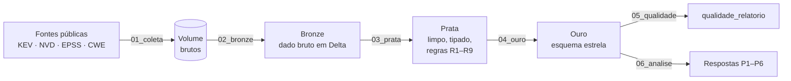

| Notebook | Função |
|---|---|
| [`00_configuracao`](notebooks/00_configuracao.py) | Parâmetros compartilhados; cria esquema e Volume |
| [`01_coleta`](notebooks/01_coleta.py) | Copia os arquivos brutos para o Volume e registra a linhagem em `bronze_log_coleta` |
| [`02_bronze`](notebooks/02_bronze.py) | Lê os arquivos e grava tabelas `bronze_*` sem alterar o conteúdo |
| [`03_prata`](notebooks/03_prata.py) | Aplica as regras de negócio R1–R9 e grava tabelas `prata_*` |
| [`04_ouro`](notebooks/04_ouro.py) | Monta o modelo dimensional; grava comentários (catálogo) e chaves no Unity Catalog |
| [`05_qualidade`](notebooks/05_qualidade.py) | Executa 42 regras de qualidade e grava `qualidade_relatorio` |
| [`06_analise`](notebooks/06_analise.py) | Consultas SQL que respondem P1–P6 |

Além dos notebooks, o repositório tem uma **réplica local** do pipeline
([`scripts/pipeline_local.py`](scripts/pipeline_local.py) e [`scripts/analise_local.py`](scripts/analise_local.py)),
que aplica as mesmas regras em pandas e executa **o mesmo texto SQL** das células do notebook 06
(extraído automaticamente do arquivo) usando DuckDB. Ela serviu para validar a lógica e gerar os
gráficos deste README; os números conferem com a execução no Databricks.

---

## 3. Busca e coleta dos dados

### 3.1 Fontes escolhidas

As bases foram escolhidas **depois** das perguntas, pelo critério de conseguirem respondê-las:

| Fonte | O que fornece | Por que foi escolhida |
|---|---|---|
| **NIST NVD** (API CVE 2.0) | Universo de CVEs, com data de publicação, nota e métricas CVSS e tipo de falha (CWE) | É a referência oficial de CVEs; define a população sobre a qual se decide |
| **CISA KEV** | CVEs com exploração confirmada, data de inclusão, prazo de correção, fornecedor, produto, uso em ransomware | É a melhor "verdade" pública sobre exploração real |
| **FIRST EPSS** — retrato atual e retrato de 01/01/2025 | Probabilidade prevista de exploração por CVE | O retrato histórico permite o teste prospectivo de P3, sem usar informação do futuro |
| **MITRE CWE** (visão 1000) | Nome oficial de cada tipo de falha | Legibilidade da análise por CWE |

### 3.2 Registro da coleta

| Arquivo | Data da coleta | Volume | Formato original |
|---|---|---|---|
| `kev.json` | 28/09/2026 (versão do catálogo 2026.09.27) | 1.728 CVEs · 1,8 MB | JSON |
| `nvd_cves.ndjson.gz` | 28/09/2026 | 170.006 CVEs publicadas de 01/01/2021 a 31/12/2025 · 70,8 MB (3,4 MB compactado) | JSON paginado da API → NDJSON |
| `epss_scores-current.csv.gz` | 28/09/2026 (scores de 28/09/2026, modelo v2026.06.15) | 380.224 CVEs · 2,7 MB | CSV compactado |
| `epss_scores-2025-01-01.csv.gz` | 28/09/2026 (scores de 01/01/2025, modelo v2023.03.01) | 271.765 CVEs · 1,6 MB | CSV compactado |
| `cwe_1000.csv.zip` | 28/09/2026 | 944 fraquezas · 0,6 MB | CSV compactado |

* O **NVD** foi coletado pelo script [`scripts/coleta_nvd.py`](scripts/coleta_nvd.py): consultas à API
  em janelas de 90 dias (a API limita cada consulta a 120 dias), 2.000 CVEs por página, respeitando o
  limite de requisições sem chave (pausa de 6,5 s). A coleta levou cerca de 21 minutos, é retomável e
  grava apenas os 15 campos usados. O log está em [`dados/brutos/coleta_nvd.log`](dados/brutos/coleta_nvd.log).
* As demais fontes são arquivos baixados diretamente dos sites oficiais (sem *web scraping*).
* Como todas as licenças permitem redistribuição (seção 10), os arquivos brutos estão versionados
  em [`dados/brutos/`](dados/brutos). O notebook `01_coleta` os copia do repositório (clonado no
  Databricks como *Git folder*) para o Volume `/Volumes/workspace/mvp_vuln/brutos`, garantindo que a
  execução na nuvem use exatamente o mesmo retrato dos dados. Com o parâmetro `modo = fontes`, o
  mesmo notebook baixa as versões mais recentes direto das fontes.

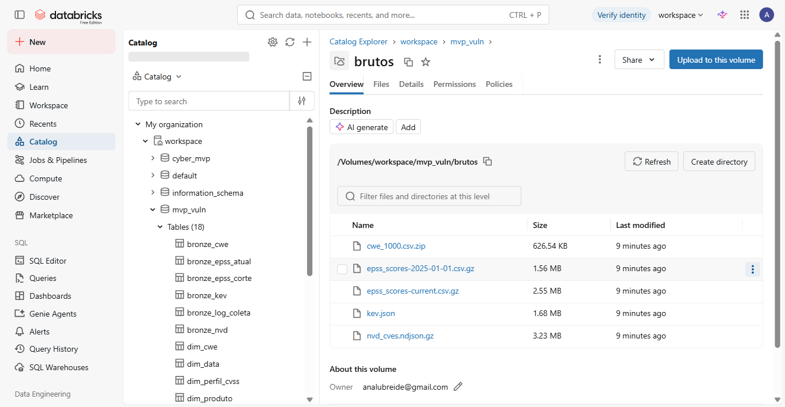

---

## 4. Modelagem

Modelo dimensional em **esquema estrela**, com duas tabelas fato que compartilham dimensões
(constelação de fatos). Diagrama completo, decisões de modelagem e fluxo de linhagem em
[**`catalogo/modelo_dados.md`**](catalogo/modelo_dados.md); **Catálogo de Dados** completo (tipo,
descrição, domínio com mínimos e máximos, obrigatoriedade e linhagem de cada atributo) em
[**`catalogo/catalogo_dados.md`**](catalogo/catalogo_dados.md).

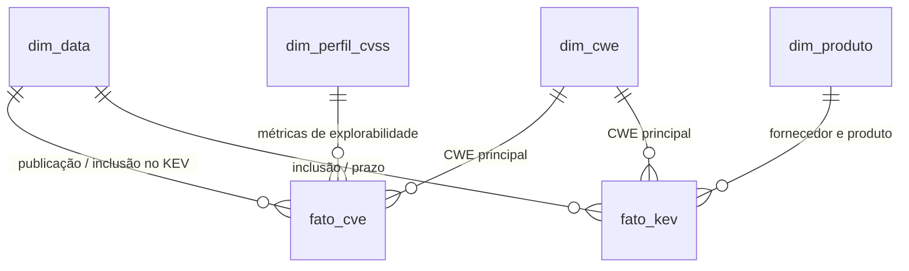

| Tabela | Grão | Linhas |
|---|---|---|
| `fato_cve` | Uma CVE publicada no NVD entre 2021 e 2025 (não rejeitada) | 162.145 |
| `fato_kev` | Uma entrada do catálogo KEV (catálogo completo) | 1.728 |
| `dim_data` | Um dia do calendário, 2002–2026 (papéis: publicação, inclusão, prazo) | 9.131 |
| `dim_cwe` | Um tipo de fraqueza (MITRE + códigos genéricos do NVD) | 975 |
| `dim_perfil_cvss` | Uma combinação de vetor de ataque, complexidade, privilégios e interação (dimensão *junk*) | 49 |
| `dim_produto` | Um par fornecedor/produto do KEV | 719 |

Por que **duas** tabelas fato: `fato_cve` contém exploradas e não exploradas, o que é indispensável
para medir taxas e comparar políticas (P1–P4, P6); `fato_kev` contém fornecedor, produto e ransomware,
atributos que só existem para as exploradas, e cobre também CVEs publicadas antes de 2021 (P5).

As descrições do catálogo foram gravadas como **comentários de tabela e coluna no Unity Catalog**, e as
chaves primárias e estrangeiras como restrições informativas, de modo que o catálogo também é
consultável dentro da plataforma:

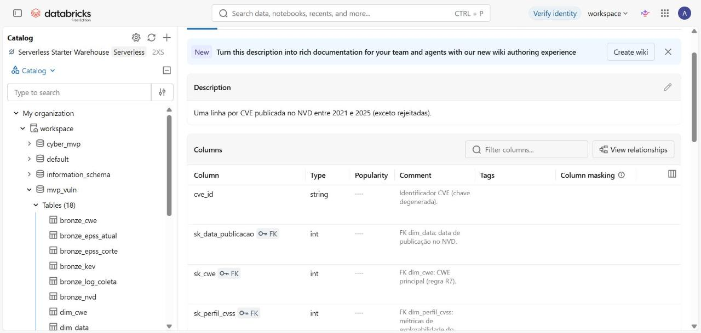

A partir dessas chaves, o próprio Unity Catalog desenha o diagrama entidade-relacionamento da tabela fato:

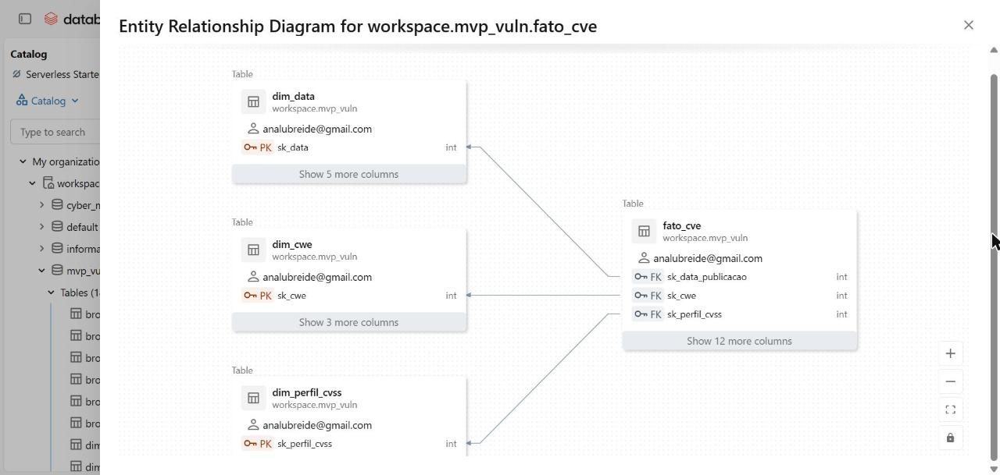

---

## 5. Carga (pipeline ETL)

### 5.1 Orquestração

As seis etapas são encadeadas em um **Job do Databricks** (definição em
[`pipeline/job_mvp_vulnerabilidades.json`](pipeline/job_mvp_vulnerabilidades.json)):
`coleta → bronze → prata → ouro → qualidade → analise`. Cada tarefa só inicia se a anterior terminar
com sucesso, e todas as tabelas são regravadas (`overwrite`) a cada execução, o que torna o pipeline
**idempotente**: rodar de novo produz o mesmo resultado.

A execução oficial ocorreu em 28/09/2026 em computação *serverless*: as seis tarefas terminaram com sucesso em **5 min 56 s** no total, e as contagens e respostas obtidas no Databricks coincidem exatamente com as da réplica local.

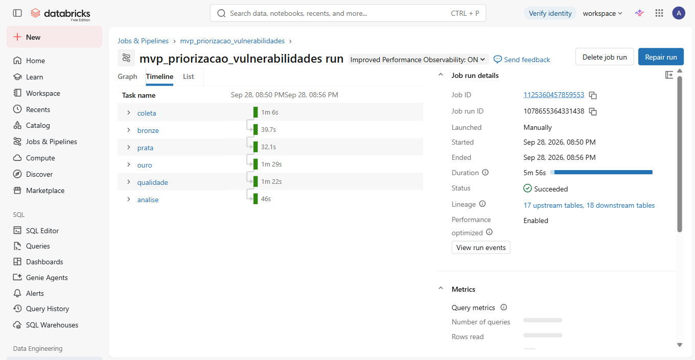

### 5.2 Regras de transformação

Regras que afetam a interpretação dos resultados (implementadas em `03_prata` e `04_ouro`):

| # | Regra | Efeito na carga de 28/09/2026 |
|---|---|---|
| R1 | `cve_id` padronizado (sem espaços, maiúsculas) em todas as fontes: é a chave de junção | Nenhum ID fora do padrão |
| R2 | NVD: deduplicação por `cve_id`, mantendo o registro modificado mais recentemente | 0 duplicatas encontradas |
| R3 | NVD: CVEs com status `Rejected` são excluídas | **7.861 CVEs removidas** (4,6%) |
| R4 | CVSS: usa a versão 3.1 (ou 3.0), preferindo a nota *Primary* do NVD; na falta dela, a nota do fabricante (CNA) | 30,2% das notas vêm do fabricante |
| R5 | Nota fora de [0, 10] vira nula; faixa qualitativa recalculada pela tabela oficial do CVSS v3 | 0 casos |
| R6 | CVE sem CVSS v3 fica na faixa `Sem CVSS` (não é descartada) | 3.102 CVEs (1,9%) |
| R7 | Uma CWE principal por CVE: a primeira específica (`CWE-n`); senão a genérica do NVD; senão `SEM-CWE` | 17,7% das CVEs tinham mais de uma CWE |
| R8 | KEV: `Known` → ransomware `true`; `Unknown` → `false` ("sem evidência pública", não "nunca usado") | 361 entradas `true` |
| R9 | EPSS: conversão para número; uma linha por CVE | 0 duplicatas |

**Conciliação entre fontes.** As três fontes são unidas por `cve_id` com junções à esquerda a partir
do NVD (a população). Uma CVE ausente do KEV é considerada **não explorada**; ausente do EPSS de
01/01/2025, recebe EPSS 0 no teste prospectivo (497 casos, 0,3%).

### 5.3 Persistência

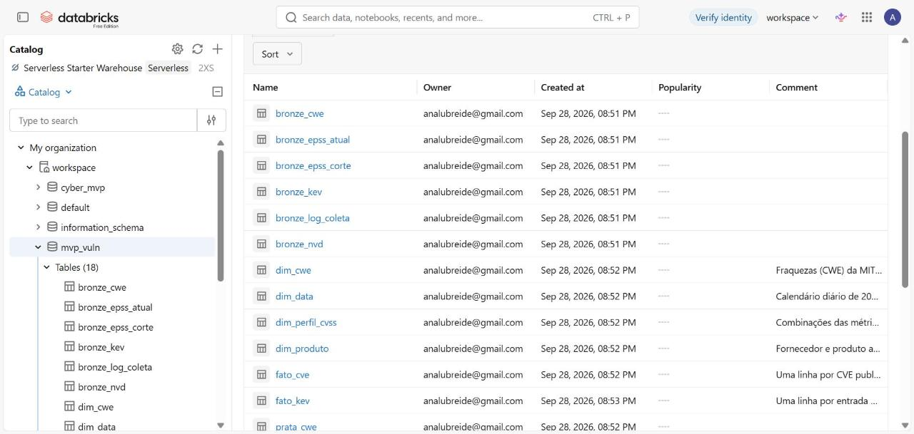

---

## 6. Análise de qualidade dos dados

Foram avaliadas **42 regras** sobre todos os atributos relevantes, cobrindo completude, unicidade,
conformidade, consistência, acurácia, atualidade, integridade referencial e cobertura entre fontes.
As regras ficam em um arquivo único ([`scripts/regras_qualidade.py`](scripts/regras_qualidade.py))
usado pelo Databricks e pela réplica local. O relatório completo está em
[`docs/resultados/qualidade_relatorio.csv`](docs/resultados/qualidade_relatorio.csv).

**Resultado:** das 31 regras do tipo *violação*, 30 não encontraram nenhum problema de formato, domínio,
duplicidade ou integridade referencial. A única com ocorrências é a de CVEs rejeitadas, que a regra R3 remove.
As bases são curadas por órgãos oficiais. Os achados relevantes são **características das fontes que
condicionam a análise**:

| Atributo | Dimensão | Achado | Impacto e tratamento |
|---|---|---|---|
| `status_nvd` | acurácia | 7.861 CVEs **rejeitadas** (4,6%) | Excluídas (R3): não são vulnerabilidades válidas |
| `status_nvd` | atualidade | 25.747 CVEs (15,1%) **não analisadas** pelo NVD (`Deferred`/aguardando análise), reflexo do atraso de processamento do NVD desde 2024 | Mantidas; explicam parte das CVEs sem CVSS/CWE |
| `cvss_score` | completude | 3.102 CVEs **sem CVSS v3** (1,9%; 5,7% entre as de 2025) | Faixa `Sem CVSS` (R6). Nenhuma delas está no KEV, porque o NVD prioriza a análise das CVEs exploradas: a ausência de nota **não** indica baixo risco |
| `cvss_fonte` | consistência | 30,2% das notas são do **fabricante**, não do NVD | Aceitas (R4); fabricantes tendem a avaliar as próprias falhas com menos severidade, uma fonte de ruído no CVSS |
| `cwes` / `cwe_principal` | completude / acurácia | 8,3% das CVEs só têm CWE **genérica** (`NVD-CWE-noinfo`/`Other`) ou nenhuma | Mantidas como categorias próprias em `dim_cwe` |
| `cwes` (KEV) | completude | 175 entradas do KEV (10,1%) sem CWE | `SEM-CWE` (R7) |
| `dias_ate_kev` | consistência | 62 CVEs entraram no KEV **antes** de serem publicadas no NVD | Mantidas: são *zero-days*, explorados antes da divulgação (resultado de P6) |
| `cve_id` (KEV × NVD) | cobertura | 9 CVEs do KEV com identificador de 2021–2025 não estão na população | ID reservado em um ano e publicado em outro; efeito desprezível |
| `epss` | completude | 100% das CVEs da população têm EPSS atual | — |

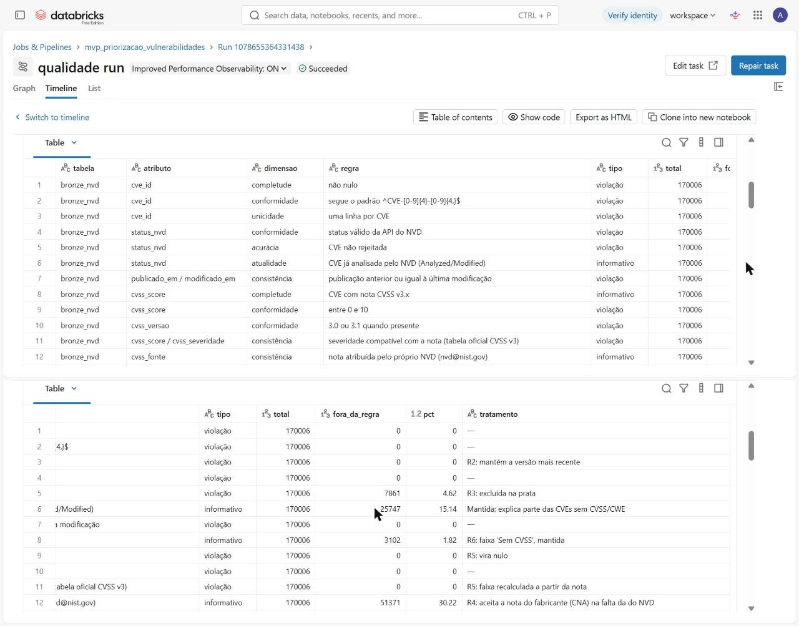

---

## 7. Solução do problema: respostas às perguntas

**População:** 162.145 CVEs publicadas no NVD de 2021 a 2025, das quais **867 (0,53%)** estão no
catálogo KEV. Os resultados de cada consulta estão em [`docs/resultados/`](docs/resultados).

> **Convenções.** *Explorada* = consta do KEV. *Esforço* = número (ou %) de CVEs que a política manda
> corrigir. *Cobertura* = % das exploradas que a política captura. *Eficiência* = % das CVEs
> selecionadas que foram de fato exploradas.

### P1 · Que fração das CVEs é explorada, por faixa de severidade?

| Faixa CVSS | CVEs | % das CVEs | Exploradas | % das exploradas | Taxa de exploração |
|---|---:|---:|---:|---:|---:|
| Crítica (9–10) | 22.564 | 13,9% | 313 | 36,1% | **1,39%** |
| Alta (7–8,9) | 60.290 | 37,2% | 446 | **51,4%** | 0,74% |
| Média (4–6,9) | 72.905 | 45,0% | 105 | 12,1% | 0,14% |
| Baixa (0,1–3,9) | 3.282 | 2,0% | 3 | 0,3% | 0,09% |
| Nenhuma / Sem CVSS | 3.104 | 1,9% | 0 | 0% | 0% |

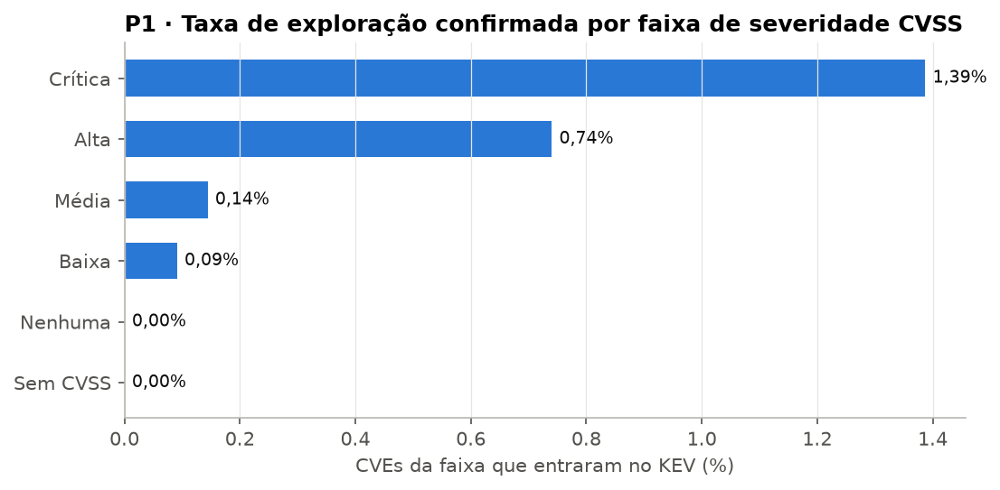

**Discussão.** A exploração é rara: **uma em cada 187 CVEs** foi explorada comprovadamente. O CVSS
**carrega sinal**: uma CVE Crítica tem taxa de exploração ~10 vezes maior que uma Média. Mas o sinal é
fraco em termos absolutos: mesmo entre as Críticas, **98,6% nunca foram exploradas**, e a maior parte
das exploradas (51%) está na faixa Alta, não na Crítica. Um em cada oito casos explorados (12%) está na
faixa Média, que a regra "Alta ou Crítica" ignora. O zero na faixa "Sem CVSS" não deve ser lido como
"CVE sem nota é segura": o NVD prioriza a análise de CVEs que entram no KEV, então a causalidade é
inversa.

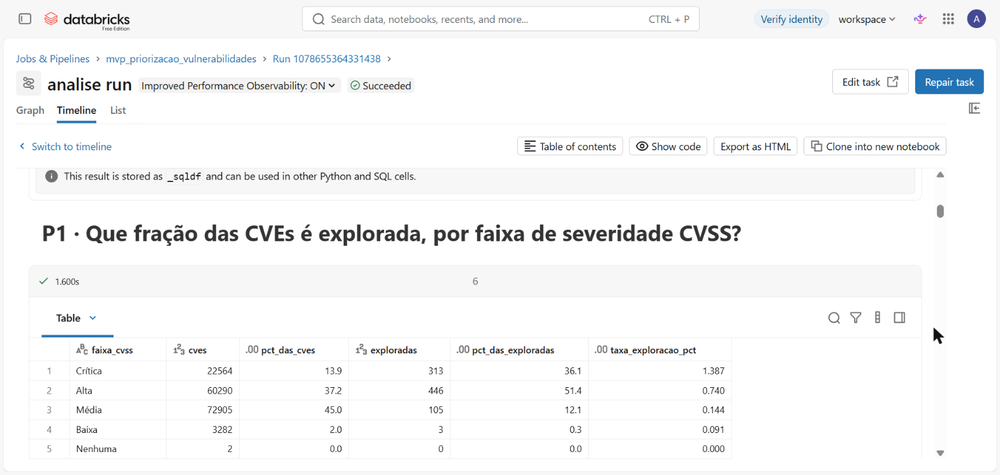

### P2 · Priorizar por CVSS alto é eficiente? (EPSS atual)

| Política | Esforço | Cobertura | Eficiência |
|---|---:|---:|---:|
| CVSS ≥ 9 (Crítica) | 22.564 (13,9%) | 36,1% | 1,39% |
| EPSS top-N, **mesmo esforço** de CVSS ≥ 9 | 22.564 (13,9%) | **93,2%** | 3,58% |
| CVSS ≥ 7 (Alta ou Crítica) | 82.854 (51,1%) | 87,5% | 0,92% |
| EPSS top-N, **mesmo esforço** de CVSS ≥ 7 | 82.854 (51,1%) | 98,7% | 1,03% |
| EPSS ≥ 0,10 | 4.584 (2,8%) | 71,5% | **13,53%** |
| EPSS ≥ 0,01 | 35.681 (22,0%) | 95,8% | 2,33% |

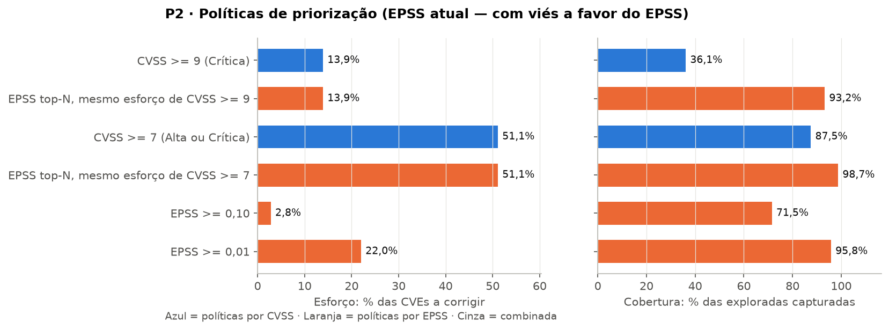

**Discussão.** À primeira vista, a hipótese se confirma com folga: a regra "CVSS ≥ 7" manda corrigir
**metade de todas as CVEs** para cobrir 87,5% das exploradas, enquanto "EPSS ≥ 0,10" cobre 71,5%
corrigindo apenas 2,8%, com eficiência 15 vezes maior. **Mas essa comparação é injusta a favor do
EPSS**: o EPSS de hoje é calculado com informação acumulada depois da publicação, incluindo sinais de
exploração observados (a própria entrada no KEV, relatos de ataque, código de exploração publicado).
Em parte, ele "já sabe a resposta". Por isso a pergunta P3 refaz o teste sem olhar o futuro.

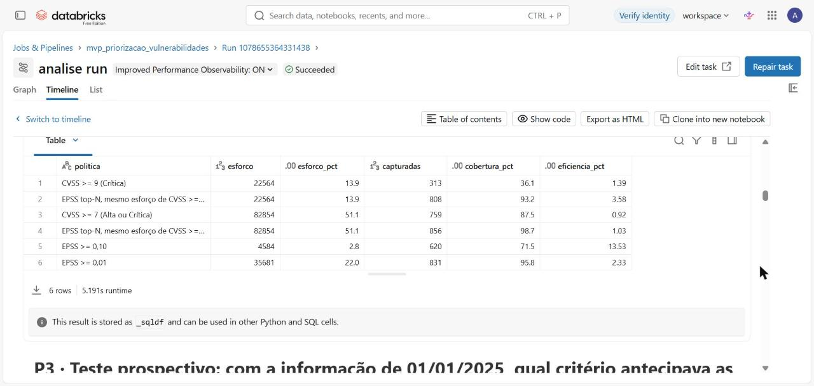

### P3 · Teste prospectivo: com a informação de 01/01/2025, qual critério antecipava as explorações seguintes?

Desenho do teste: população de **113.394 CVEs** publicadas de 2021 a 2024 que **ainda não estavam** no
KEV em 01/01/2025; desfecho: entrar no KEV entre 01/01/2025 e 27/09/2026 (**72 CVEs**); preditores:
CVSS e o **EPSS publicado em 01/01/2025**.

| Política | Esforço | Cobertura (de 72) | Eficiência |
|---|---:|---:|---:|
| CVSS ≥ 9 (Crítica) | 16.267 (14,3%) | 24 (33,3%) | 0,15% |
| EPSS top-N, mesmo esforço de CVSS ≥ 9 | 16.267 (14,3%) | 23 (31,9%) | 0,14% |
| CVSS ≥ 7 (Alta ou Crítica) | 59.983 (52,9%) | **65 (90,3%)** | 0,11% |
| EPSS top-N, mesmo esforço de CVSS ≥ 7 | 59.983 (52,9%) | 44 (61,1%) | 0,07% |
| EPSS ≥ 0,10 | 1.033 (0,9%) | 8 (11,1%) | **0,77%** |
| EPSS ≥ 0,01 | 4.319 (3,8%) | 15 (20,8%) | 0,35% |
| CVSS ≥ 7 **e** EPSS ≥ 0,01 | 3.822 (3,4%) | 15 (20,8%) | 0,39% |

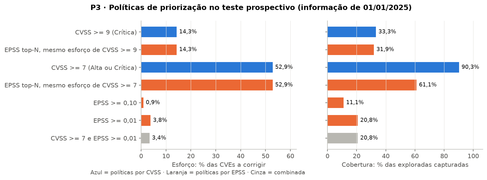

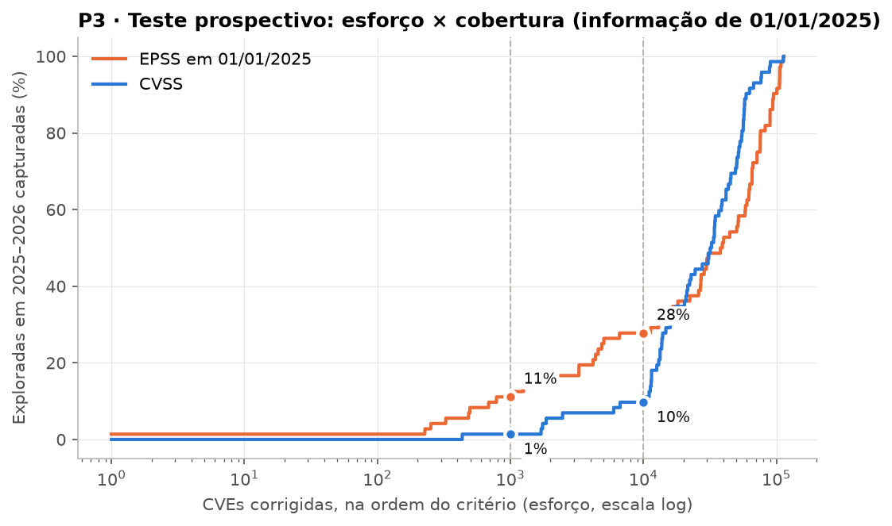

**Discussão.** Sem acesso ao futuro, o quadro muda e **a hipótese é só parcialmente confirmada**:

* **Com orçamento pequeno, o EPSS vence.** Corrigindo as 1.000 CVEs mais bem colocadas, o EPSS captura
  11% das exploradas seguintes e o CVSS, 1%; com 10.000, 28% contra 10%. A eficiência de "EPSS ≥ 0,10"
  (0,77%) é **7 vezes** a de "CVSS ≥ 7" (0,11%).
* **Com orçamento grande, o CVSS vence.** No esforço de "CVSS ≥ 7" (metade das CVEs), o CVSS captura
  90% das exploradas e o EPSS só 61%. As curvas se cruzam por volta de 15 mil CVEs.
* **Por quê:** a mediana do EPSS de 01/01/2025 dessas 72 CVEs era **0,00095** (percentil 41): para o
  modelo, a maioria parecia improvável. Já 65 das 72 tinham CVSS ≥ 7. O EPSS estima a chance de
  exploração **nos próximos 30 dias**, enquanto o teste mede exploração ao longo de **quase 21 meses**, e
  mede justamente as explorações **tardias** de CVEs antigas (as rápidas já estavam no KEV em
  01/01/2025 e foram excluídas pelo desenho). O EPSS é um bom radar de curto prazo, não um preditor de
  longo prazo; o CVSS funciona como uma rede larga e barata de calcular, mas pouco seletiva.
* **Cautela estatística:** são apenas 72 eventos; cada CVE vale 1,4 ponto percentual de cobertura.
  O modelo EPSS de 2025 (v2023.03.01) também já foi substituído por uma versão mais nova. As notas CVSS
  usadas são as atuais, possivelmente revistas depois de 01/01/2025, o que dá ao CVSS uma leve vantagem.

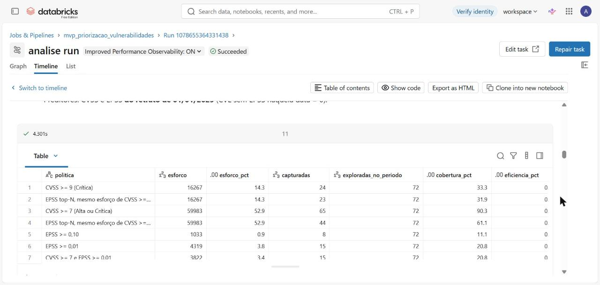

### P4 · Que características técnicas estão super-representadas entre as exploradas?

`razão` = taxa de exploração da categoria ÷ taxa geral (1 = média).

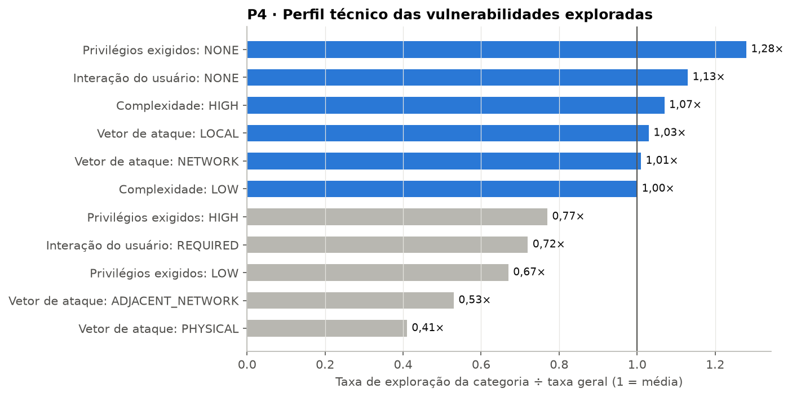

| CWE (tipo de falha) | CVEs | Exploradas | % das exploradas | Razão |
|---|---:|---:|---:|---:|
| CWE-787 Out-of-bounds Write | 8.518 | 78 | 9,0% | 1,7× |
| CWE-416 Use After Free | 4.049 | 62 | 7,2% | 2,9× |
| NVD-CWE-noinfo (sem classificação) | 9.605 | 62 | 7,2% | 1,2× |
| CWE-78 OS Command Injection | 3.131 | 59 | 6,8% | 3,5× |
| CWE-22 Path Traversal | 4.158 | 49 | 5,7% | 2,2× |
| CWE-502 Deserialization of Untrusted Data | 1.661 | 38 | 4,4% | 4,3× |
| CWE-94 Code Injection | 1.935 | 33 | 3,8% | 3,2× |
| CWE-306 Missing Authentication for Critical Function | 1.205 | 26 | 3,0% | 4,0× |
| CWE-843 Type Confusion | 419 | 25 | 2,9% | **11,2×** |
| CWE-287 Improper Authentication | 1.597 | 22 | 2,5% | 2,6× |
| *Para comparação:* CWE-79 Cross-site Scripting | 26.170 | 17 | 2,0% | **0,12×** |
| *Para comparação:* CWE-89 SQL Injection | 10.027 | 15 | 1,7% | 0,28× |

**Discussão.** As métricas de explorabilidade do CVSS discriminam pouco: **não exigir privilégios**
(1,28×) e **não exigir interação do usuário** (1,13×) aumentam a taxa, mas o vetor de ataque
"rede" não se distingue de "local" (1,01× e 1,03×). Isso é coerente com ataques reais em cadeia: uma
falha remota dá o primeiro acesso e uma falha local eleva o privilégio (ex.: `Win32k`, P5). O **tipo
de falha** discrimina muito mais: *type confusion* (típica de motores JavaScript de navegadores),
desserialização, ausência de autenticação e injeção de comandos são exploradas de 3 a 11 vezes mais
que a média. No outro extremo, **XSS é a CWE mais comum (16% das CVEs) e uma das menos exploradas**
(0,12×). Uma política que pondere a CWE reduziria bastante o esforço desperdiçado.

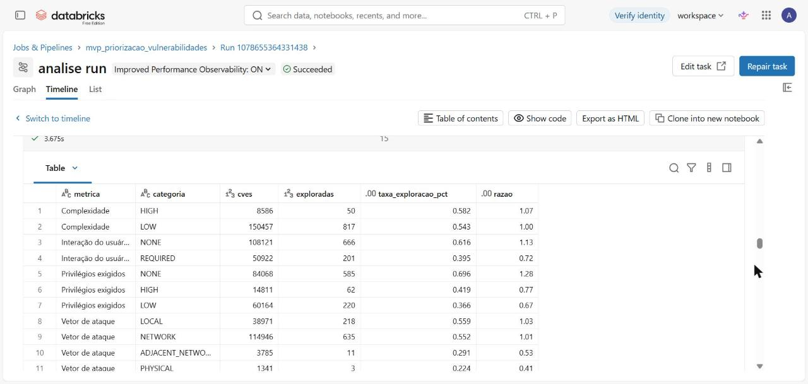

### P5 · Quais fornecedores e produtos concentram as exploradas e o uso em ransomware?

Catálogo KEV completo: 1.728 entradas, 283 fornecedores, 719 produtos.

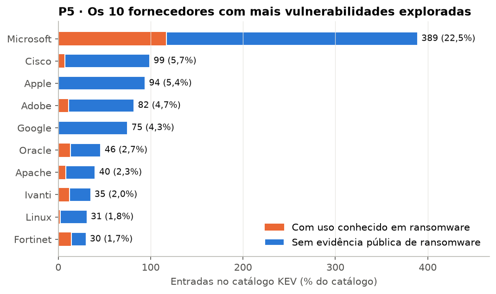

| Produto | Entradas no KEV | Com ransomware |
|---|---:|---:|
| Microsoft Windows | 174 | 49 |
| Apple Multiple Products | 53 | 0 |
| Google Chromium V8 | 41 | 0 |
| Microsoft Internet Explorer | 36 | 6 |
| Adobe Flash Player | 33 | 5 |
| Linux Kernel | 31 | 2 |

**Discussão.** A concentração é alta: a **Microsoft sozinha responde por 22,5%** do catálogo, os 5
maiores fornecedores por 42,8% e os 10 maiores por 53,3%. Ao mesmo tempo, a cauda é longa: 145 dos
283 fornecedores têm uma única entrada, então nenhum inventário pode ignorar fornecedores pequenos.
O uso em **ransomware** (20,9% do catálogo) se concentra em **infraestrutura corporativa e de
perímetro**: Fortinet (46,7%), VMware (34,6%), Ivanti (34,3%), Microsoft (30,1%) e Oracle (28,3%).
Apple e Google têm **zero** casos de ransomware: suas falhas exploradas estão em celulares e
navegadores, alvos típicos de espionagem, não de sequestro de dados. Para uma organização, isso sugere
tratar VPNs, *firewalls*, virtualização e servidores Windows como prioridade máxima de monitoramento.

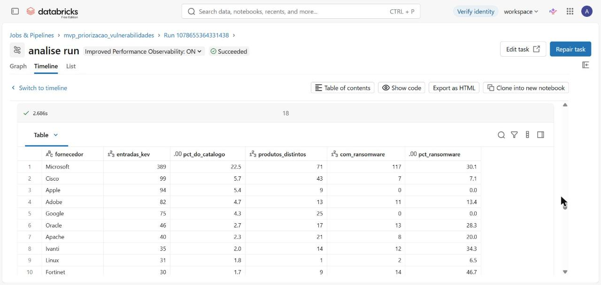

### P6 · Quanto tempo entre a publicação da CVE e a inclusão no KEV?

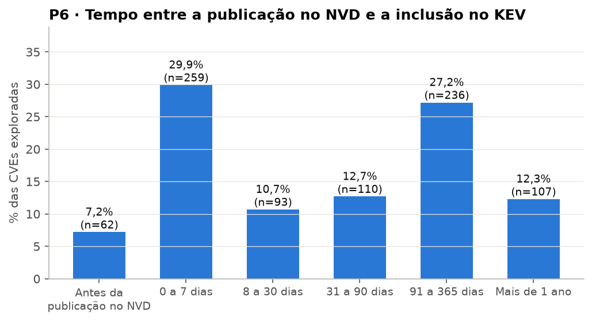

| Ano de publicação | Exploradas | Mediana (dias) | Até 7 dias | Até 30 dias |
|---|---:|---:|---:|---:|
| 2021 | 214 | 206 | 3,7% | 8,4% |
| 2022 | 131 | 24 | 38,9% | 51,9% |
| 2023 | 165 | 6 | 52,7% | 64,8% |
| 2024 | 160 | 11 | 48,8% | 59,4% |
| 2025 | 197 | 8 | 49,2% | 64,0% |

**Discussão.** Das 867 CVEs exploradas, **7,2% entraram no KEV antes de serem publicadas no NVD**
(*zero-days*) e **37% em até 7 dias** após a publicação. De 2023 a 2025, a mediana ficou entre 6 e
11 dias, e cerca de metade das exploradas foi confirmada na primeira semana. A mediana alta de 2021
(206 dias) é um **artefato**: o KEV só foi criado em novembro de 2021 e começou incorporando o
passivo acumulado. Nos anos recentes há **censura à direita**: CVEs de 2025 ainda podem entrar no
catálogo nos próximos meses, o que elevará a mediana desse ano.

O prazo de correção que a CISA dá aos órgãos federais é de **21 dias** (mediana; 95,5% das inclusões
desde 2022). Nos anos de 2023 a 2025, 59% a 65% das exploradas entraram no KEV em até 30 dias: um ciclo mensal
de atualizações, comum em empresas, chega **depois** da confirmação de exploração na maioria dos casos. Para as exploradas, **o tempo de reação disponível é de dias,
não de semanas**.

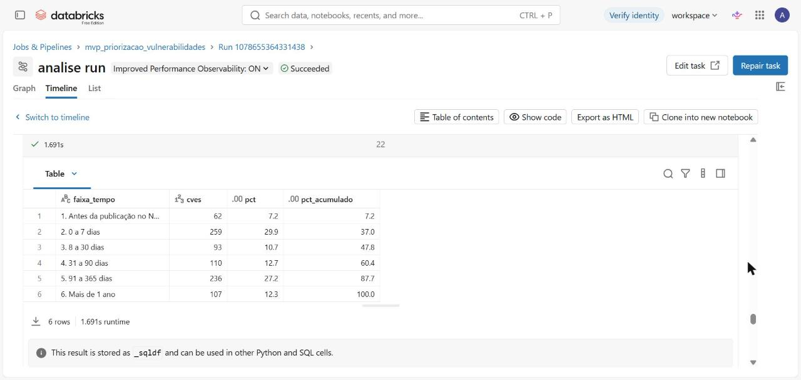

---

## 8. Discussão geral

A pergunta central era **se a priorização por CVSS alto é um bom critério**. A resposta dos dados
é mais matizada do que a hipótese inicial:

1. **O CVSS não é inútil, mas é pouco seletivo.** Ele ordena o risco na direção certa (P1) e, como
   rede larga, captura a maior parte das explorações futuras (90% em P3), mas ao custo de mandar
   corrigir metade de todas as vulnerabilidades, com eficiência de cerca de 1 em 1.000.
2. **O EPSS é um excelente radar de curto prazo, mas não substitui a rede larga.** Com poucos
   recursos, ele encontra muito mais exploradas por CVE corrigida (P3: 7× mais eficiente no limiar
   0,10). Sua vantagem espetacular em P2 é inflada por informação posterior, e sua capacidade de
   prever explorações tardias é limitada pelo horizonte de 30 dias.
3. **O sinal mais forte é a própria confirmação de exploração**, e ela chega rápido (P6): metade das
   exploradas recentes entra no KEV em até uma semana.
4. **O contexto técnico e de negócio acrescenta sinal barato:** o tipo de falha (P4) e o tipo de
   produto (P5, infraestrutura de perímetro para ransomware) discriminam mais do que as métricas do
   próprio CVSS.

**Recomendação resultante do MVP**, uma política em camadas em vez de uma regra única:

| Camada | Critério | Prazo sugerido | Fundamento |
|---|---|---|---|
| 1 — Emergência | CVE no KEV, sobretudo em ativos de perímetro | dias (≤ 7) | P5, P6 |
| 2 — Urgente | EPSS ≥ 0,10 **ou** CWE de alto risco (type confusion, desserialização, falta de autenticação, injeção de comando) | ≤ 21 dias | P3, P4 |
| 3 — Rotina | CVSS ≥ 7 restantes | ciclo mensal | P1, P3 (cobertura) |
| 4 — Oportunista | Demais | próxima janela de manutenção | — |

Resultado negativo relevante: a hipótese de que o EPSS **dominaria** o CVSS em qualquer orçamento
**foi refutada** no teste prospectivo. O MVP gerou aprendizado validado justamente por ter separado
a comparação ingênua (P2) da honesta (P3).

---

## 9. Viabilidade técnica, financeira e desejabilidade

| Dimensão | Evidência neste MVP |
|---|---|
| **Técnica** | Pipeline completo (coleta → bronze → prata → ouro → qualidade → análise) executado de ponta a ponta no Databricks, orquestrado por Job, com dados persistidos em tabelas Delta e Volume do Unity Catalog (seção 5) |
| **Financeira** | Todas as fontes são gratuitas. O volume é pequeno (≈ 10 MB compactados; maior tabela com 380 mil linhas). No Databricks Free Edition o custo é **zero**. Em ambiente pago, uma execução diária do job em computação *serverless* leva poucos minutos; estimativa grosseira de poucos dólares a algumas dezenas de dólares por mês, a confirmar na tabela de preços vigente. A coleta incremental do NVD (só CVEs modificadas no dia) reduziria ainda mais o custo |
| **Desejabilidade** | O usuário é a equipe de gestão de vulnerabilidades de qualquer organização (inclusive órgãos públicos brasileiros, sujeitos a normas de segurança do GSI/PR). As perguntas respondem a uma decisão real e recorrente, e a recomendação da seção 8 é diretamente aplicável |

---

## 10. Ética, licenciamento e proteção de dados

* **Licenças.** KEV: CC0 1.0 (domínio público). NVD: dados do governo dos EUA, domínio público
  (*"This product uses data from the NVD API but is not endorsed or certified by the NVD."*).
  EPSS: uso livre com atribuição ao FIRST. CWE: termos de uso da MITRE, que permitem reprodução com
  atribuição. Todas permitem redistribuição e uso derivado, por isso os dados brutos estão versionados.
  Detalhes em [`LICENSE`](LICENSE).
* **Dados pessoais (LGPD, Lei nº 13.709/2018).** Nenhuma das bases contém dados pessoais: os registros
  descrevem falhas de software, fornecedores e produtos. Não foi necessária anonimização.
* **Dados corporativos.** Não foram usados.
* **Uso responsável.** O trabalho usa apenas metadados públicos sobre vulnerabilidades e não contém
  código de exploração. Seu objetivo é defensivo: ajudar a decidir o que corrigir primeiro.
* **Coleta automatizada.** A API do NVD foi usada dentro do limite de requisições publicado pelo NIST.

---

## 11. Autoavaliação

**Quais perguntas foram respondidas e quais não foram?** As seis perguntas foram respondidas com
dados. A P3 foi a mais importante e a que mais mudou minha visão: planejei o trabalho esperando
confirmar que o EPSS supera o CVSS, e a comparação ingênua (P2) parecia confirmar isso. O teste
prospectivo mostrou que a resposta depende do orçamento. A P3 foi respondida só parcialmente, porque
72 eventos são poucos para conclusões firmes, sobretudo nas políticas mais restritivas. A P6 também
tem uma limitação: a mediana de 2021 é distorcida pela criação do catálogo e a de 2025 ainda não está
fechada (censura à direita).

**Que limitações dos dados condicionaram os resultados?**
* O **KEV é um limite inferior** da exploração real: inclui só o que a CISA confirmou e para o que
  existe orientação de correção, com viés para produtos usados pelo governo americano. Uma CVE fora do
  KEV não é necessariamente "não explorada".
* O **EPSS atual incorpora informação do futuro** (motivo da P3), e o retrato histórico disponível
  usa um modelo antigo.
* As **notas CVSS** mudam ao longo do tempo e 30% vêm do próprio fabricante; o atraso do NVD deixou
  15% das CVEs sem análise.
* **Fornecedor e produto** só estão disponíveis para as CVEs do KEV, o que impediu calcular a taxa de
  exploração por fornecedor (só a concentração).

**Que decisões técnicas eu tomaria de outra forma?**
* Coletaria **vários retratos históricos do EPSS** (por exemplo, trimestrais) para repetir o teste
  prospectivo em várias datas de corte e medir a estabilidade do resultado, em vez de uma só data.
* Modelaria a relação CVE × CWE com uma **tabela ponte**, em vez de uma CWE principal, já que 17,7%
  das CVEs têm mais de uma.
* Usaria uma **chave da API do NVD** desde o início, reduzindo a coleta de ~20 minutos para poucos
  minutos, e faria a coleta dentro do próprio Databricks.

**Que extensões transformariam o MVP em uma solução de uso contínuo?**
* Execução **diária e incremental** do job (NVD por data de modificação, KEV e EPSS do dia) com
  histórico versionado (Delta *time travel*), mantendo séries temporais do EPSS por CVE.
* Cruzamento com o **inventário de ativos** da organização (via CPE) para gerar a fila de correção
  real de cada equipe, e um **painel** (Databricks SQL Dashboard) com a política em camadas da seção 8.
* Incluir sinais adicionais: existência de código de exploração público e menções em fontes de
  inteligência de ameaças, e avaliar um modelo próprio que combine CVSS, EPSS, CWE e tipo de produto.

---

## 12. Como reproduzir

### No Databricks (execução oficial)

1. Crie uma conta gratuita no [Databricks Free Edition](https://www.databricks.com/learn/free-edition).
2. Em **Workspace → Create → Git folder**, informe a URL deste repositório. Os notebooks e os dados
   brutos ficam disponíveis no workspace.
3. **Opção A (notebooks):** abra e execute, em ordem, `notebooks/01_coleta` a `notebooks/06_analise`
   (cada um chama `00_configuracao` automaticamente).
   **Opção B (job):** em **Jobs & Pipelines → Create → Job**, crie as seis tarefas conforme
   [`pipeline/job_mvp_vulnerabilidades.json`](pipeline/job_mvp_vulnerabilidades.json) (substitua
   `SEU-EMAIL-DATABRICKS` pelo seu usuário) e clique em **Run now**.
4. Os resultados ficam no esquema `workspace.mvp_vuln` (Catalog Explorer).

### Localmente (validação)

```bash
pip install -r requirements.txt
```

```bash
python scripts/pipeline_local.py
```

```bash
python scripts/analise_local.py
```

Para atualizar os dados do NVD (≈ 20 minutos sem chave de API):

```bash
python scripts/coleta_nvd.py --inicio 2021-01-01 --fim 2025-12-31 --saida dados/brutos/nvd_cves.ndjson
```

---

## 13. Estrutura do repositório

| Caminho | Conteúdo |
|---|---|
| `README.md` | Este documento: objetivo, perguntas, metodologia, resultados e autoavaliação |
| [`notebooks/`](notebooks) | Notebooks Databricks 00–06 (coleta, bronze, prata, ouro, qualidade, análise) |
| [`scripts/`](scripts) | Coleta do NVD, regras de qualidade e réplica local do pipeline |
| [`pipeline/`](pipeline) | Definição do Job do Databricks |
| [`catalogo/`](catalogo) | Catálogo de Dados e diagrama do modelo |
| [`dados/brutos/`](dados/brutos) | Arquivos brutos coletados em 28/09/2026 |
| [`docs/figuras/`](docs/figuras) | Gráficos deste README |
| [`docs/resultados/`](docs/resultados) | Resultado de cada consulta (CSV) e relatório de qualidade |
| [`evidencias/`](evidencias) | Capturas de tela da execução no Databricks |
| `LICENSE` | Licença do código (MIT) e registro das licenças dos dados |

---

## 14. Referências

* CISA. *Known Exploited Vulnerabilities Catalog*. https://www.cisa.gov/known-exploited-vulnerabilities-catalog
* NIST. *National Vulnerability Database — CVE API 2.0*. https://nvd.nist.gov/developers/vulnerabilities
* FIRST. *Exploit Prediction Scoring System (EPSS)*. https://www.first.org/epss
* Jacobs, J.; Romanosky, S.; Edwards, B.; Adjerid, I.; Roytman, M. *Exploit Prediction Scoring System (EPSS)*. Digital Threats: Research and Practice, 2021.
* FIRST. *Common Vulnerability Scoring System v3.1: Specification Document*. https://www.first.org/cvss/v3.1/specification-document
* MITRE. *Common Weakness Enumeration (CWE)*. https://cwe.mitre.org
* Kimball, R.; Ross, M. *The Data Warehouse Toolkit*. 3. ed. Wiley, 2013.
