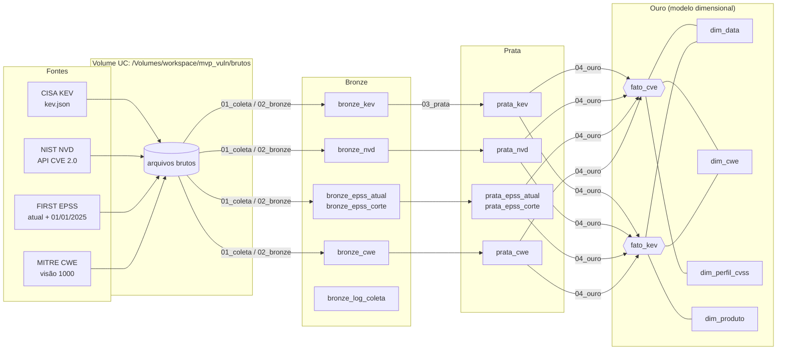
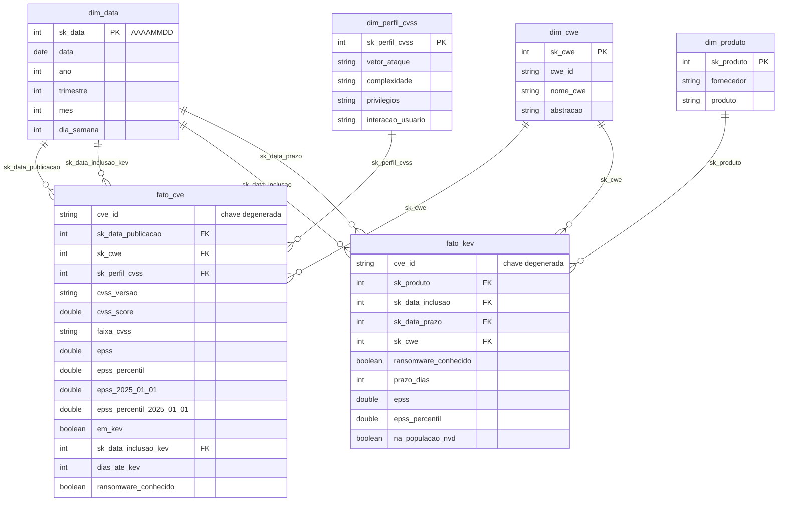

# Modelo de dados

## Arquitetura em camadas (medalhão) no Databricks

## Esquema dimensional (camada ouro)

Constelação de fatos: um **esquema estrela** com duas tabelas fato que compartilham as
dimensões `dim_data` e `dim_cwe`. As duas fatos têm grãos diferentes e por isso não foram fundidas:

| Tabela fato | Grão | Por que existe |
|---|---|---|
| `fato_cve` | uma CVE publicada no NVD entre 01/01/2021 e 31/12/2025 (não rejeitada) | É o universo sobre o qual uma equipe precisa decidir o que corrigir: permite comparar exploradas × não exploradas (P1 a P4, P6) |
| `fato_kev` | uma entrada do catálogo KEV (catálogo completo, 2021-11-03 em diante) | Contém fornecedor/produto e ransomware, que só existem para CVEs exploradas, inclusive as publicadas antes de 2021 (P5) |

`dim_data` é uma dimensão com múltiplos papéis (*role-playing*): data de publicação,
data de inclusão no KEV e prazo de correção. `dim_perfil_cvss` é uma dimensão *junk*:
reúne as quatro métricas de explorabilidade do CVSS, que isoladas teriam 2 a 4 valores cada.

### Decisões de modelagem

* **Uma CWE por CVE.** 17,7% das CVEs da população têm mais de uma CWE. Uma tabela ponte
  (CVE × CWE) seria mais fiel, mas duplicaria contagens nas análises por CWE; optou-se por
  uma CWE principal (regra R7) e a lista completa permanece em `prata_nvd.cwes`.
* **Fornecedor/produto só para o KEV.** O NVD informa produtos por meio de CPEs, que
  exigiriam um tratamento de conciliação à parte. Como a pergunta P5 é sobre o que foi
  explorado, o fornecedor do KEV é suficiente e já vem padronizado pela CISA.
* **Chaves substitutas** (`sk_*`) inteiras nas dimensões; `sk_data` no formato `AAAAMMDD`
  para leitura direta. Chaves primárias e estrangeiras são registradas no Unity Catalog como
  restrições informativas (notebook 04).
